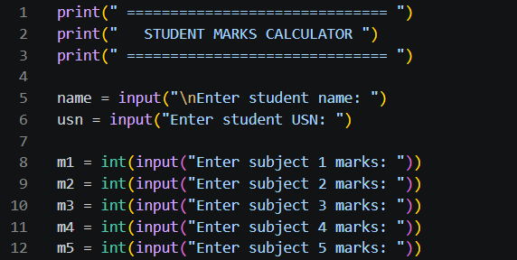
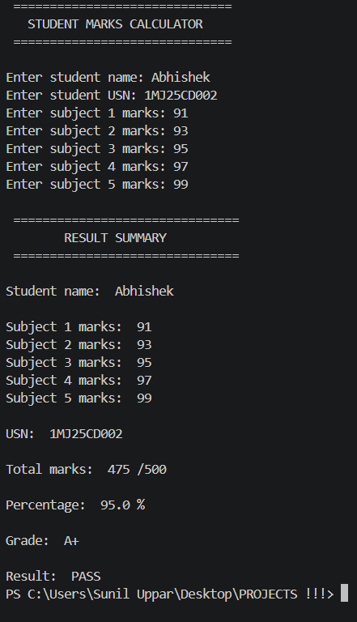

# Student Marks Calculator

## About
A beginner-friendly Python project that calculates student marks and generates academic results.

## Features
- Student name and USN
- Five subject marks
- Total marks calculation
- Percentage calculation
- Grade calculation
- Pass or Fail status
- Input validation

## Technologies Used
- Python
- Visual Studio Code
- GitHub Desktop

## How to Run
1. Install Python.
2. Download this repository.
3. Open the project folder in VS Code.
4. Run:

python Students_marks.py

## Author
Abhishek Uppar

## Screenshots

### Program Input

### Program Output

